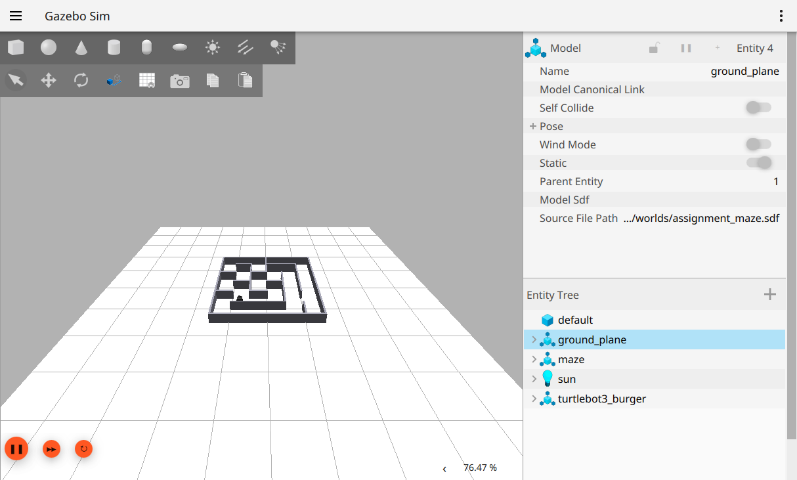
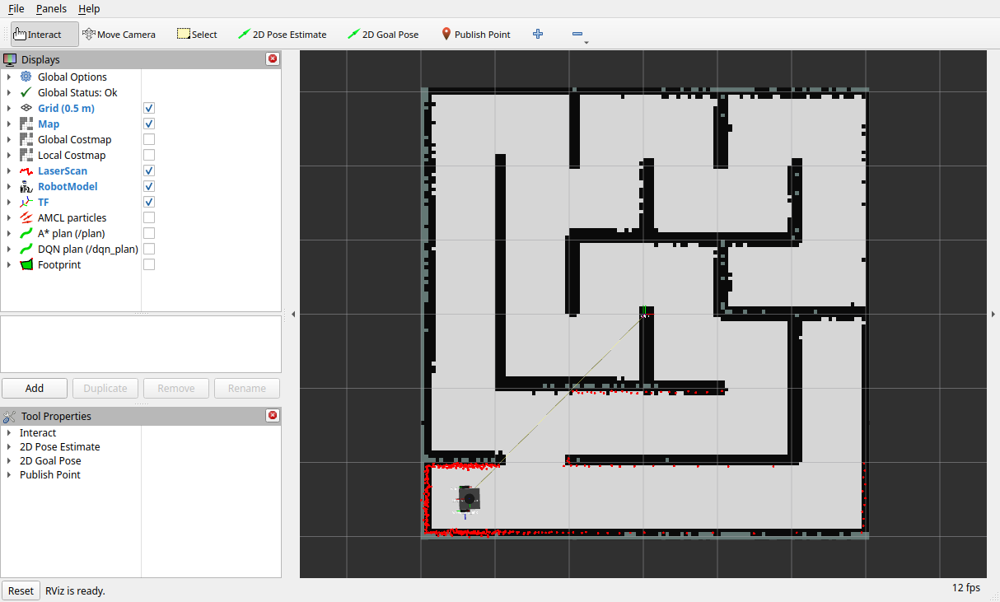
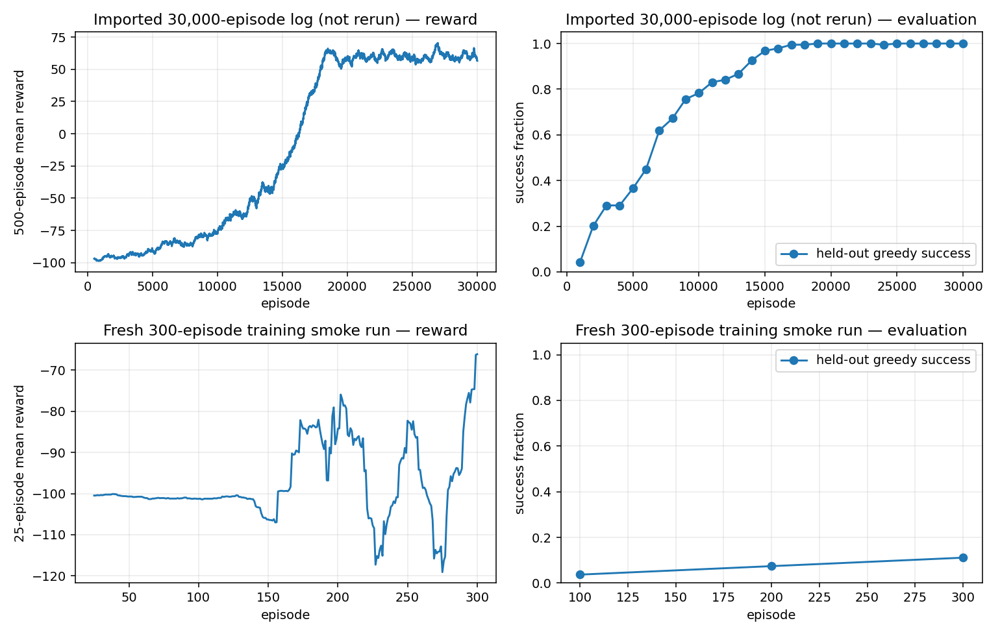
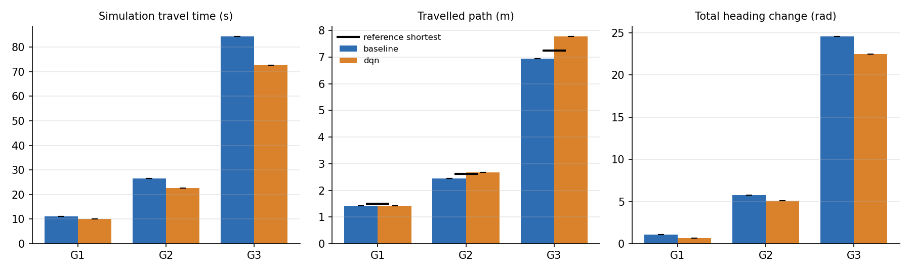

# Autonomous Navigation of TurtleBot3 Burger in Gazebo

IE4060 — Robotics and Intelligent Systems, Assignment 02, SLIIT.
Audit date: 17 October 2026. Student names/IDs: **complete before submission**.
GitHub repository: **add repository URL before submission**.

## 1. Objectives and verified system

The project navigates a simulated TurtleBot3 Burger through a maze using ROS 2
Jazzy and Gazebo Harmonic. It supports LiDAR mapping, localization, interactive
map goals and two global route methods: Nav2 Smac A* and a goal-conditioned Deep
Q-Network. Both methods share Nav2's local controller and robot dynamics.

This report distinguishes inherited assets from newly observed behavior. The
original code, supplied checkpoint, maps and old trial files were preserved in
Git commit 1952a2e. New measurements are in results/current; raw logs are in
evidence/logs. The original assignment PDF was unavailable. The user supplied
image.png containing Figure 1, which was directly inspected for maze geometry.

The VM runs Ubuntu 24.04.5 x86_64 with 7.8 GiB RAM. Native Jazzy packages supply
Harmonic 8.15.0, Nav2 1.3.13 and SLAM Toolbox 2.8.5. CPU PyTorch 2.14.1 is isolated
in a project virtual environment. Both ROS packages built successfully, and
11 automated tests passed. The original hardcoded paths and external map path
were repaired rather than replacing the existing architecture.

<!-- pagebreak -->

# 2. Maze, robot and architecture

Figure 1 has a six-by-six grid with 0.5 m pitch. Eighteen wall segments reproduce
the thick boundary and internal walls; thin guide lines are excluded. The
reference image visually agrees with the existing segment arrangement, including
the upper-right vertical wall. The SDF uses 0.05 m thick, 0.30 m high walls with
matching collision and visual boxes. A compatible .world deliverable links to
the same SDF. The floor and physics remain in Gazebo, not a conceptual grid demo.

Clear straight corridor width is 0.45 m. The spawn at (-1.25,-1.25,0) has 0.225 m
wall clearance. The primitive Burger model uses 0.033 m wheel radius and 0.160 m
wheel separation; its approximate circumscribed radius is 0.124 m. Global planning
uses a 0.13 m circle. DQN edges require 0.154 m clearance. Local control checks the
configured polygon; a chassis contact sensor records wall-contact events.

The ROS–Gazebo bridge carries clock, 360-beam LiDAR, odometry, joint states,
contacts and velocity commands. Robot state publisher supplies fixed transforms
from the URDF. The transform chain is map -> odom -> base_footprint -> base_link
-> base_scan. AMCL or SLAM owns map -> odom, with only one active at a time.
All robotics nodes use simulation time.

A material simplification is inherited: Gazebo publishes model-pose odometry
with Gaussian noise. Wheel odometry is retained separately. Thus localization
uses a more accurate motion source than a real differential-drive robot normally
has. The model uses simplified geometry and modified wheel/caster contacts;
it represents Burger dimensions rather than an untouched official model.

The default OGRE2 renderer crashed in Mesa EGL. The tested solution is
`render_engine:=ogre` on the VM desktop using llvmpipe. This is software rendering;
it worked with actual LiDAR publication. No operating-system replacement or
unrelated package removal was needed.

<!-- pagebreak -->

# 3. Mapping, localization and navigation

SLAM Toolbox constructs an occupancy grid from timestamped LiDAR and odometry
transforms. A scripted rotate-then-drive tour supplies motion instead of keyboard
teleoperation. It does not draw the map. The configuration uses 0.025 m cells,
3.5 m maximum scan range and scan matching. Loop closing is disabled in the
inherited configuration because repetitive corridors caused false matches in
previous work; that historical explanation is not a fresh controlled comparison.

The old map in maps/slam was supplied with the project. It was loaded by
map_server and AMCL for the six comparison trials. It must not be described as
a new mapping result. A separate live mapping run was started after stopping
navigation. Runtime inspection confirmed fresh occupancy publication from SLAM,
alongside real scan, odometry, clock and TF messages. The completed 55-waypoint tour took 346 wall seconds. Its map is saved in
maps/current/maze.yaml and maze.pgm: 121 by 122 cells at 0.025 m. Wall distance
median/p95 is 0.012/0.056 m; 90.3% of occupied cells lie within 0.05 m of a wall
and 100% within 0.10 m. Reference free-space coverage is 78.9%; wall thickness
and unobserved margins limit this metric. A first map save missed the publication
window; transient-local subscription with a 10-second save timeout succeeded.

AMCL localizes the robot on the saved map. SmacPlanner2D computes a cost-aware A*
route; earlier documentation calling this Dijkstra was corrected. The Regulated
Pure Pursuit controller tracks the route with velocity limits, collision checks
and inflation costs. Velocity smoothing constrains the final commands. Recovery
behaviors include spin, backup and wait. Typical speed limit is 0.22 m/s.

RViz's 2D Goal Pose publishes a map-frame PoseStamped to /clicked_goal. The
adapter rejects occupied, unknown and insufficient-clearance goals. Baseline
mode uses Nav2 NavigateToPose; DQN mode constructs a checked continuous path and
uses FollowPath. Results include actual odometric distance, elapsed simulation
and wall time, position error and contact events. Wall-clock timeout also bounds
execution if the simulation clock stalls.

<!-- pagebreak -->

# 4. Deep Q-learning and evaluation

The DQN operates on a 36-node lattice extracted from the occupancy map. An
80-element state encodes one-hot robot and goal cells, four local valid-move
flags and normalized robot/goal coordinates. Four actions move along cardinal
edges. Each edge is checked against the continuous map and robot clearance.
This is map-based learned route planning, not learned wheel-velocity control.

The neural network is an MLP with two 256-unit ReLU hidden layers and four Q
outputs. Replay stores up to 100,000 transitions; batches contain 128 samples.
Adam uses learning rate 0.0005 and discount 0.97. Epsilon decreases from 1.0 to
0.05. Double DQN uses the online network to select the next action and the target
network to evaluate it; target weights copy every 1,000 steps. Huber loss and
gradient clipping stabilize training. The configured full run has 30,000 episodes.

The Bellman target is y = r + gamma(1-d) Q_target(s', argmax_a Q_online(s',a)).
Rewards are +100 for reaching the goal, -100 for a blocked move, and -1 per step
plus Euclidean distance-progress shaping. Goal and collision terminate episodes;
a 60-step limit truncates them, with bootstrapping retained through the timeout.
Checkpoints persist weights, architecture and lattice signature. A signature
mismatch rejects a changed map; there is no classical route fallback.

The supplied checkpoint was freshly evaluated without exploration or learning.
It succeeded on 1,071/1,071 training pairs and 189/189 held-out pairs. All successful
routes matched BFS shortest length on this four-connected lattice. BFS is used
only as an evaluation reference. These are other start/goal pairs on the same
maze, not unseen-maze generalization. Continuous connectors and shared Nav2
execution were separately exercised in Gazebo on all three selected scenarios.

A new 300-episode smoke run completed 4,371 steps in 181 seconds and saved a
checkpoint. It achieved only 21/189 (11.11%) held-out successes, with 168 loops.
Its short-run results are preserved separately. It is not a replacement for the
supplied trained policy or evidence of newly reproduced full convergence. The
original 30,000-episode learning log is inherited evidence and is labelled as such.

<!-- pagebreak -->

# 5. Experiments and results

Both methods started at (-1.25,-1.25,0). G1 targets (0.25,-1.25,0), G2 targets
(-1.25,0.75,1.5708), and G3 targets (1.25,0.25,0). The runner resets the Gazebo
pose and AMCL before each trial, outside measurement, and publishes the same
goal topic used by RViz. This batch has one trial per method/scenario; it does
not establish statistical reliability. A separate GUI verification selected all
three goals through real RViz SetGoal mouse events; all three succeeded. Their
actual pixel-selected coordinates and records are in clicked_trials.csv.

| Goal/method | Sim s | Wall s | Actual m | True error m | Contacts |
|---|---|---|---|---|---|
| G1 A* | 11.09 | 13.54 | 1.420 | 0.084 | 0 |
| G1 DQN | 10.16 | 11.75 | 1.419 | 0.084 | 0 |
| G2 A* | 26.44 | 32.75 | 2.446 | 0.110 | 0 |
| G2 DQN | 22.57 | 26.64 | 2.680 | 0.092 | 0 |
| G3 A* | 84.34 | 97.15 | 6.949 | 0.129 | 0 |
| G3 DQN | 72.56 | 82.45 | 7.778 | 0.144 | 0 |

All six met the recorded success rule: successful action, position error at most
0.15 m and no chassis-wall contact. Ground-truth final positions were queried
from Gazebo. Near-obstacle scan events were A*: 0,1,16 and DQN: 0,4,4 for G1–G3.
Zero chassis contacts does not prove that no other part ever touched an obstacle.

DQN was faster on these runs, with greater angular velocity RMS on the harder
routes. A* travelled less on G2 and G3. Network inference speed alone does not
explain physical travel time; route shape and shared controller behavior matter.

<!-- pagebreak -->

# 6. Metrics, limitations and conclusion

Travel distance is L = sum_i sqrt((x_i-x_(i-1))^2+(y_i-y_(i-1))^2), integrated from
odometry. Travel time is final minus initial simulation time; wall time is
reported separately. Real-time factor is simulation time / wall time. Final
error is Euclidean distance to the requested goal, using a Gazebo pose query.
Heading-change sum is sum_i |wrap(yaw_i-yaw_(i-1))|. Angular RMS is
sqrt(mean(angular_velocity^2)). Noise and sampling influence these estimates.

The analysis script estimates a reference route with eight-connected Dijkstra
on the occupancy map at 0.154 m clearance, snapping endpoints to safe cells.
Its diagnostic efficiency ratio is reference distance / actual distance. Ratios
above one occur because the robot stops within goal tolerance, and the reference
has different clearance and endpoint assumptions from Nav2. These values are
not a fair bounded optimality score; use measured distance and success alongside
them. DQN grid efficiency uses BFS on the same lattice and is a separate metric.

Automated verification covers maze collision/visual consistency, goal/spawn
clearance, map image coordinates, connectivity, environment collision behavior,
online-network learning updates, target synchronization, checkpoint loading and
continuous DQN paths to three goals. Eleven tests passed; both packages built.
Typed runtime probes received scan/odom/clock/TF/map messages and a real ROS
publish/subscribe exchange. Logs preserve failures during environment recovery,
including the OGRE2 crash and premature smoke-checkpoint evaluation attempt.

Limitations include one comparison trial per case, one maze, accurate pose-derived
odometry, disabled loop closing, chassis-only contact detection and a tight
0.15 m final-position tolerance. The DQN far trial finished at 0.144 m error,
so repeated trials and improved localization/control tuning are advisable.
Fresh SLAM completed independently and its saved map is kept separate.
Loading the inherited navigation map is never counted as new mapping.

The implementation now executes both classical and learned navigation in the
actual VM/Gazebo stack. The strongest evidence is the six logged successful
trials and independently reevaluated checkpoint, with limitations stated above.
Before submission, add student details and the GitHub URL, compare against the
full assignment PDF, inspect the report and repeat the live VIVA demonstration.

Sources: Gazebo Harmonic ROS installation documentation,
https://gazebosim.org/docs/harmonic/ros_installation/ (Jazzy/Harmonic pairing);
project source, image.png and current raw experiment logs. The official ROS
installation webpage was inaccessible during this audit; repository setup uses
ros-infrastructure/ros-apt-source's released Debian package.
